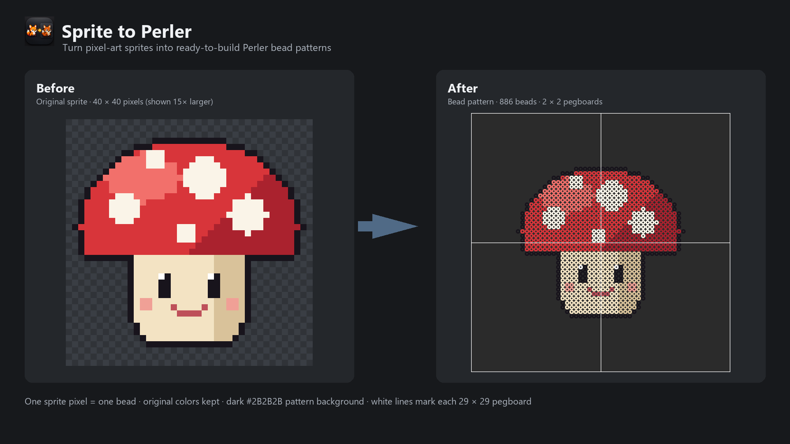
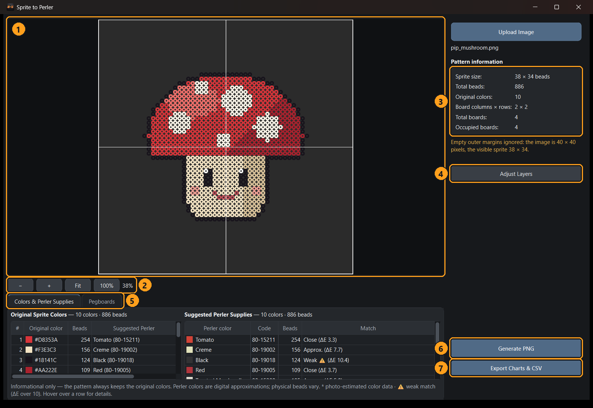

# Sprite to Perler

**Turn pixel-art sprites into ready-to-build Perler bead patterns on Windows.**



Sprite to Perler converts a PNG or GIF sprite into a finished bead pattern. Every pixel of the
sprite becomes one bead in its original color, laid out on standard 29 × 29 pegboards. The app
counts every bead, suggests Perler colors to buy, and exports numbered charts for each pegboard.
It works completely offline — no account, no internet connection.

> **Status:** pre-release. No download is published yet.

## Features

- **Automatic conversion** — drop a sprite on the window and the pattern appears immediately.
- **One pixel = one bead** — original colors, black outlines and transparency are kept exactly.
- **Bead-style preview** — round beads with holes on a dark background, white lines marking each
  29 × 29 pegboard; zoom from overview to actual size.
- **Background handling** — transparent backgrounds are used as-is; a single solid background
  color is removed automatically, or the app asks when it is unsure.
- **Automatic fit to pegboards** — empty outer margins are ignored: the visible sprite is centered
  on the smallest rectangle of complete 29 × 29 pegboards that holds it. Your sprite file is never
  changed.
- **Bead counts** — total beads, beads per color and beads per pegboard.
- **Perler supply suggestions** — the closest Perler color for each sprite color, with how
  close the match is (informational only; the pattern is never recolored).
- **Adjust Layers** — optionally fine-tune the position of the sprite, the bead rings and the
  pegboard lines, with clear warnings when something no longer lines up.
- **Exports** — a full-resolution pattern PNG, one numbered chart per pegboard, a board-layout
  map, and CSV files for colors, Perler supplies and board counts.
- **Large sprites** — up to 2,048 × 2,048 pixels (about 71 × 71 pegboards).



## Download and run (Windows 11, 64-bit; Windows 10 not yet tested)

When a release is published, it will be a ZIP file containing a portable program — nothing to
install:

1. Download the ZIP and extract it.
2. Open the **Sprite to Perler** folder and double-click **Sprite to Perler.exe**.
3. Keep the whole folder together: the program needs its `_internal` folder.

The program is not digitally signed, so Windows SmartScreen may show "Windows protected your PC"
the first time. Choose **More info → Run anyway** only if you downloaded it from the official
project page.

## Supported input

- **PNG** and **GIF** files (for animated GIFs, the first frame is used).
- Up to **2,048 × 2,048 pixels**, at the sprite's original size (one pixel = one bead).
- Transparent backgrounds, or one solid background color.

## User guide

- [Illustrated user guide](docs/USER_GUIDE.md) (also as a printable PDF:
  `docs/Sprite-to-Perler-User-Guide.pdf`)
- [Documentation folder](docs/README.md)

## Limitations

- Converts **one sprite at a time**; it does not cut sprites out of sprite sheets. Use a separate
  sprite ripper and load each sprite on its own.
- Does **not** shrink enlarged pixel art: an image blown up 4× is treated as 4× more beads.
- **Perler color suggestions are digital approximations.** They have not been checked against
  real beads; 23 of the color values are estimates from product photos (marked `*`).
- Printed size of the exported PNG has not been verified against real pegboards.
- Very large patterns are slower to update (about 11 s per change at 1,024 × 1,024 pixels on a
  typical PC), and one PNG file is limited to about 1,000 megapixels — larger patterns can still
  be exported as per-pegboard charts.

## Building from source

Requirements: Windows (developed and tested on Windows 11), Python 3.13 (64-bit).

```
python -m venv .venv
.venv\Scripts\python.exe -m pip install -r requirements.txt
.venv\Scripts\python.exe -m perler_app
```

Run the tests:

```
.venv\Scripts\python.exe -m pytest tests
```

Build the portable program:

```
.venv\Scripts\pyinstaller.exe --noconfirm --distpath dist --workpath build packaging\sprite_to_perler.spec
```

The program is written to `dist\Sprite to Perler\`. A release ZIP should contain that folder
plus `LICENSE`, `THIRD_PARTY_NOTICES/` and the user-guide PDF.

Project layout:

- `perler_engine/` — the conversion engine (no user interface): sprite loading, bead grid,
  pegboard layout, rendering, color matching, charts and reports.
- `perler_app/` — the PySide6 Windows interface.
- `packaging/` — the PyInstaller build files.
- `tests/` — automated tests, using the example sprites in `docs/examples` and synthetic images.
- `docs/` — the user guide, screenshots, examples and documentation scripts.

## License

Sprite to Perler is free software, licensed under the **GNU General Public License version 3** —
see [`LICENSE`](LICENSE). It includes third-party components under their own licenses; see
[`THIRD_PARTY_NOTICES/`](THIRD_PARTY_NOTICES/README.md).

## Acknowledgments

- The bead-ring look comes from an original Photoshop bead template created by the project author.
- The application icon was created by the project author with ChatGPT.
- 95 Perler digital color values come from the [BeadColors](https://github.com/maxcleme/beadcolors)
  project (MIT License); 23 are estimates recorded from meltbead.com. See
  [palette provenance](THIRD_PARTY_NOTICES/PALETTE-PROVENANCE.md).
- Built with [Python](https://www.python.org), [Qt for Python (PySide6)](https://www.qt.io/qt-for-python),
  [Pillow](https://python-pillow.org) and [NumPy](https://numpy.org).

## Trademark notice

Perler is a trademark of its owner. Sprite to Perler is an independent project and is not
affiliated with, sponsored by, or endorsed by the owner of the Perler brand.
