# Sprite to Perler — User Guide

**Sprite to Perler** turns a pixel-art picture (a *sprite*) into a finished Perler bead pattern for
Windows. Each pixel of your sprite becomes one bead. The app shows you the pattern immediately,
counts every bead, suggests Perler bead colors to buy, and saves pegboard-by-pegboard charts.

This guide explains every feature, step by step. You do not need any technical knowledge.

## Contents

1. [Words used in this guide](#1-words-used-in-this-guide)
2. [Opening the app](#2-opening-the-app)
3. [The main window](#3-the-main-window)
4. [Loading a sprite](#4-loading-a-sprite)
5. [Transparent and solid-color backgrounds](#5-transparent-and-solid-color-backgrounds)
6. [Understanding the pattern preview](#6-understanding-the-pattern-preview)
7. [Zooming and moving around](#7-zooming-and-moving-around)
8. [Pattern information](#8-pattern-information)
9. [Colors and Perler supplies](#9-colors-and-perler-supplies)
10. [Pegboard counts](#10-pegboard-counts)
11. [Adjusting the layers](#11-adjusting-the-layers)
12. [Saving the pattern as a PNG](#12-saving-the-pattern-as-a-png)
13. [Exporting charts and CSV files](#13-exporting-charts-and-csv-files)
14. [Reading a pegboard chart](#14-reading-a-pegboard-chart)
15. [Large sprites](#15-large-sprites)
16. [Messages, problems and solutions](#16-messages-problems-and-solutions)
17. [What the app does not do](#17-what-the-app-does-not-do)
18. [Technical details (optional)](#18-technical-details-optional)

---

## 1. Words used in this guide

| Word | Meaning |
|---|---|
| **Sprite** | A small picture made of individual square pixels, like a character from a classic video game. |
| **Pixel** | One small colored square of a sprite. |
| **Bead** | One fused plastic bead. **In this app, one sprite pixel = one bead.** |
| **Pegboard** | The plastic board you place beads on. Here, every pegboard is **29 × 29 pegs**. Bigger sprites use several pegboards side by side. |
| **Transparency** | Parts of an image that are "see-through" (no color). Transparent pixels get **no bead**. |
| **Layer** | One part of the preview drawing that can be moved on its own: the sprite artwork, the bead rings, or the white pegboard lines. |
| **Export** | Saving files from the app to a folder of your choice (a picture, charts, or spreadsheet files). |
| **Perler color recommendation** | The app's *suggestion* of which real Perler bead color is closest to each sprite color, based on digital color data. It is a shopping aid, not a guarantee. |
| **CSV file** | A simple spreadsheet file. It opens in Microsoft Excel, LibreOffice or Google Sheets. |

---

## 2. Opening the app

Sprite to Perler is a **portable** program: there is nothing to install.

1. Open the **Sprite to Perler** folder.
2. Double-click **Sprite to Perler.exe** (it shows the fox-and-pegboard icon).

> **Important:** keep the whole **Sprite to Perler** folder together. The `.exe` file needs the
> `_internal` folder next to it. If you want to move the program, move or copy the entire folder.
> To start it from your desktop, right-click **Sprite to Perler.exe** → **Show more options** →
> **Send to** → **Desktop (create shortcut)**.

The first start can take a few seconds while Windows checks the new files; later starts are
faster. Because the program is not digitally signed, Windows may show a "Windows protected your
PC" message the first time. Choose **More info** → **Run anyway** only if you got the program from a
source you trust.

If the folder is incomplete, the app tells you so instead of starting:
"**Sprite to Perler cannot start** … The program folder is incomplete or damaged. Copy the whole
'Sprite to Perler' folder again and keep all of its files together."

---

## 3. The main window

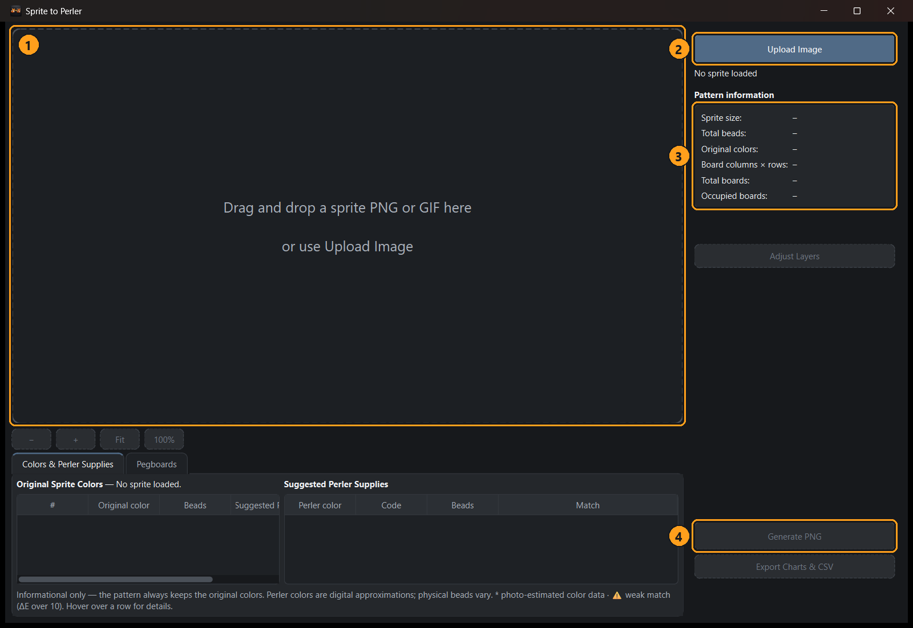

*Figure 1 — The window when it first opens.*

1. **Drop area** — drag a sprite file here.
2. **Upload Image** — choose a sprite file from your computer.
3. **Pattern information** — sizes and counts appear here after loading.
4. **Generate PNG** and **Export Charts & CSV** — greyed out (unavailable) until a sprite is loaded.

*Figure 2 — The same window after loading "Pip the mushroom".*

1. **Pattern preview** — the finished bead pattern.
2. **Zoom controls** — make the preview bigger or smaller.
3. **Pattern information** — size, bead count and pegboards.
4. **Adjust Layers** — optional fine-tuning (see section 11).
5. **Information tabs** — colors, Perler supplies and pegboard counts.
6. **Generate PNG** — save the finished pattern picture.
7. **Export Charts & CSV** — save pegboard charts and spreadsheets.

You can drag the thin divider between the preview and the information tabs up or down to give
either part more room.

---

## 4. Loading a sprite

The app accepts **PNG** and **GIF** files up to **2,048 × 2,048 pixels**. Use the sprite at its
original size: every pixel becomes one bead.

**Drag and drop**

1. Open the folder that contains your sprite in File Explorer.
2. Drag **one** sprite file onto the Sprite to Perler window and let go.

**Upload Image**

1. Click **Upload Image**.
2. Choose a `.png` or `.gif` file and click **Open**.

**Open from the program icon**

- You can also drop a sprite file directly onto the **Sprite to Perler.exe** icon (or its
  shortcut). The app opens with that sprite already loaded.

The pattern appears automatically — there is no "convert" button. Loading a new sprite replaces
the current one and starts again from the automatic layout.

**Animated GIFs**

Only the **first frame** of an animated GIF is used. The app says so below the pattern
information:

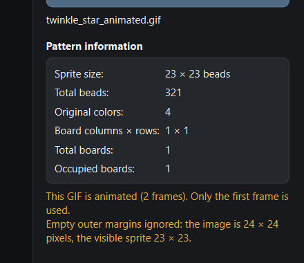

*Figure 3 — "This GIF is animated (2 frames). Only the first frame is used." The second note
explains that the 24 × 24 pixel image has an empty outer edge, so its visible sprite is 23 × 23
(see section 6).*

> Drop one file at a time. If you drop several files at once, the app asks you to drop a single
> PNG or GIF file.

### Getting single sprites from a sprite sheet

Many sprites come on a **sprite sheet**: one big image holding many poses or characters.
Sprite to Perler converts **one sprite at a time** and does not cut sheets apart itself, so use an
outside tool first:

1. Open the sprite sheet in a **sprite ripper** (also called a sprite-sheet unpacker or slicer), or
   in any image editor that can crop.
2. Cut out the single sprite you want. Keep it at its **original size** — do not enlarge or
   shrink it, or every pixel will no longer be one bead.
3. Save it as a **PNG**, ideally with a transparent background. (A single solid background color
   also works — see section 5.)
4. Load that one PNG into Sprite to Perler (drag and drop, or **Upload Image**).
5. Repeat for each sprite you want to make.

This works for sprites from any source — sprite sheets, pixel-art drawings you made yourself, or
single images you already have — as long as each file contains one sprite at its original size.

> Only use artwork you have the right to use. Many game sprites are copyrighted by their creators.

---

## 5. Transparent and solid-color backgrounds

**Transparent backgrounds (recommended).** Transparent pixels become empty pegs — no bead.

**Solid-color backgrounds.** If the image has no transparency, the app looks at its four corners.
When all four corners are the same color **and** that color is not used inside the sprite, the
color is removed automatically and a note says which color was removed:

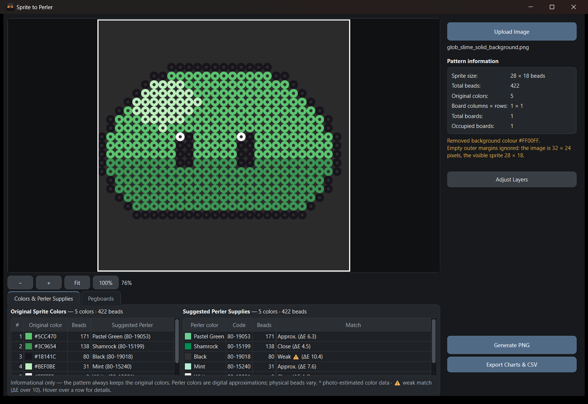

*Figure 4 — "Glob the slime", a 32 × 24 pixel image on a magenta background. Notes: "Removed
background colour #FF00FF." and "Empty outer margins ignored: the image is 32 × 24 pixels, the
visible sprite 28 × 18." The 422-bead slime fits on a single pegboard (1 × 1).*

**When the background color also appears inside the sprite**, the app asks what to do:

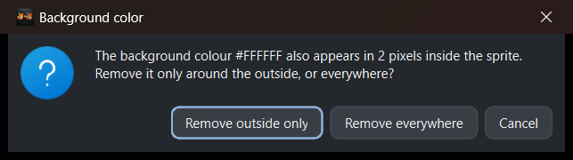

*Figure 5 — The background color (white) also appears in the slime's eyes.*

- **Remove outside only** — removes the background color only where it touches the outside edge.
  The white eye highlights stay as beads. (Usually the right choice.)
- **Remove everywhere** — removes that color from the whole image.
- **Cancel** — does not load the image.

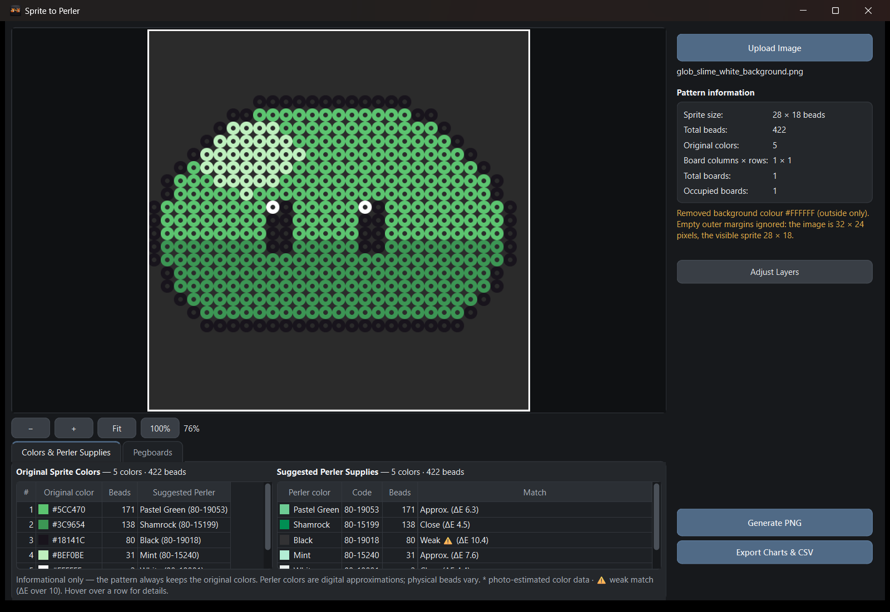

*Figure 6 — After **Remove outside only**: the white background is gone, the white eye highlights are still beads. The result is the same 422 beads on one pegboard.*

**When no background color can be identified** (for example, a full picture whose corners are
different colors), the app asks:

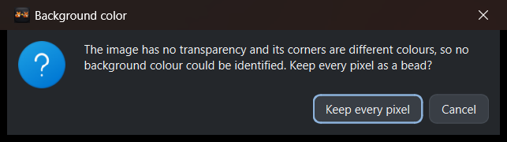

*Figure 7 — Choose **Keep every pixel** to turn every pixel into a bead, or **Cancel**.*

> **Partly transparent pixels:** pixels that are at least half visible become full beads in their
> original color; fainter ones are left empty. When this happens, a note tells you how many
> pixels were affected.

Empty borders around the sprite — transparent pixels or a removed background — never cost extra
pegboards: the layout uses only the visible sprite (see section 6). Your sprite file itself is
never changed.

---

## 6. Understanding the pattern preview

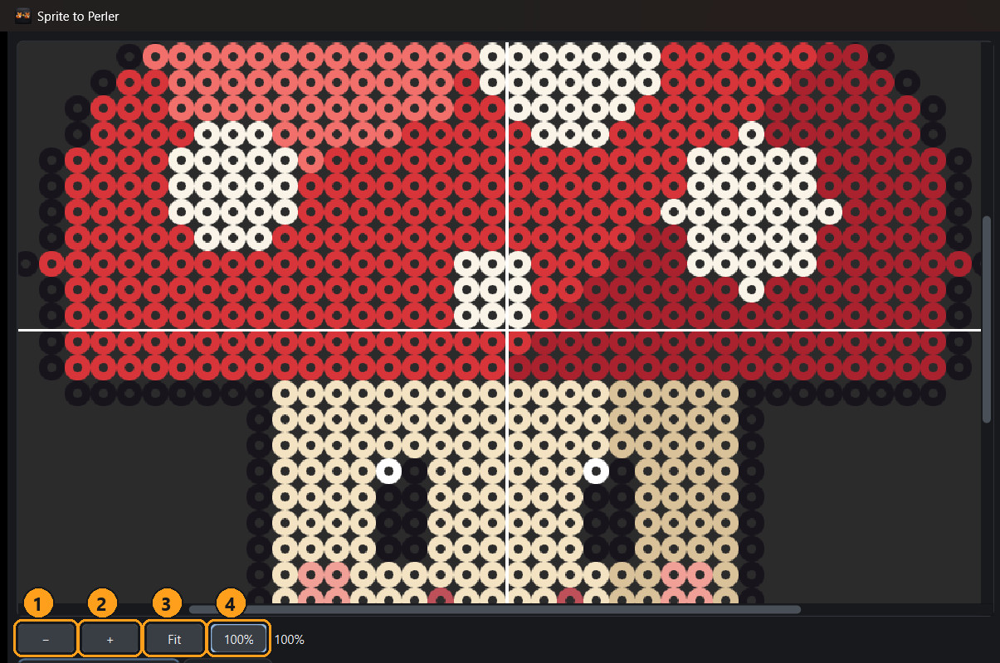

*Figure 8 — Pip at 100% zoom.*

- **Every circle is one bead**, drawn in the sprite's **original color**. The dark center is the
  bead's hole.
- The **dark gray background** (#2B2B2B) shows empty pegs.
- The **thin white lines** mark the edges of each 29 × 29 pegboard.
- The darker area around the pattern is just empty workspace.

**Automatic layout.** The app looks at the **visible sprite** — every pixel that becomes a bead —
and ignores empty outer margins (transparent pixels or a removed background around it). It then
uses the **smallest rectangle of complete 29 × 29 pegboards** that holds the visible sprite and
**centers** the sprite on it. If it cannot be centered exactly, the extra empty column goes on the
right and the extra empty row at the bottom.

- Every bead keeps its original color and its position relative to the other beads. Gaps inside
  the sprite stay empty.
- The layout is always a full rectangle of pegboards. A board inside it may be empty (for example,
  beside a diagonal sprite); it is kept so that no bead has to move.
- Only the layout ignores the margins. Your sprite file is **never changed**.

For example, "Glob the slime" is a 32 × 24 pixel image, but its visible slime is 28 × 18 pixels,
so it fits on **one** pegboard instead of two (Figure 4). Pip's 40 × 40 pixel image holds a
38 × 34 pixel mushroom, centered on 2 × 2 pegboards.

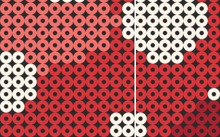

*A part of the saved pattern at actual size: each bead is 25 × 25 pixels in the saved PNG.*

> The Perler color suggestions **never** change the preview or the saved pattern. The pattern
> always uses your sprite's own colors.

---

## 7. Zooming and moving around

The zoom controls are below the preview (Figure 8):

1. **−** — zoom out one step.
2. **+** — zoom in one step.
3. **Fit** — show the whole pattern in the window.
4. **100%** — show the pattern at its real saved size (25 pixels per bead).

The percentage next to the buttons shows the current zoom.

- **Mouse wheel** over the preview — zoom in and out around the mouse pointer.
- **Click and drag** the preview — move around (pan). The scroll bars work too.

Zooming and moving only change your view. They never change the pattern.

---

## 8. Pattern information

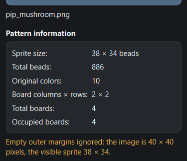

*Figure 9 — Pattern information for Pip: a 40 × 40 pixel image whose visible sprite is 38 × 34
beads, on 2 × 2 pegboards.*

| Line | Meaning |
|---|---|
| **Sprite size** | Width × height of the **visible sprite** in beads (= pixels). Empty outer margins of the image are not counted, so this can be smaller than the image file. |
| **Total beads** | How many beads the whole pattern needs. Transparent pixels are not counted. |
| **Original colors** | How many different colors the sprite uses. |
| **Board columns × rows** | How many pegboards across and down. |
| **Total boards** | Columns × rows. |
| **Occupied boards** | Boards that have at least one bead. Shows *unavailable* if the pegboard lines have been moved off the bead positions (section 11). |

Notes about your file (animated GIF, removed background, ignored empty margins, large pattern)
appear below this box in orange. When the image has empty outer margins, the note gives both
sizes, for example "Empty outer margins ignored: the image is 40 × 40 pixels, the visible
sprite 38 × 34."

---

## 9. Colors and Perler supplies

Open the **Colors & Perler Supplies** tab below the preview.

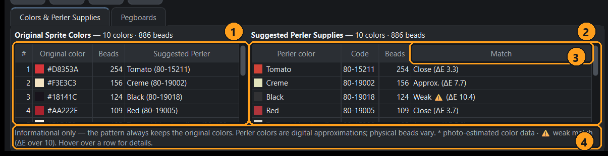

*Figure 10 — Original colors (left) and suggested Perler supplies (right).*

1. **Original Sprite Colors** — every color in your sprite with a color swatch, its color code
   (for example #D8353A), its bead count, and the suggested Perler color. Colors are numbered
   **#1, #2, …** from most used to least used; the same numbers are used in the charts.
2. **Suggested Perler Supplies** — your shopping list: Perler color name, product code, and how
   many beads you need. When several sprite colors match the same Perler color, their beads are
   added together on one line.
3. **Match** — how close the suggestion is:
   - **Close** — very similar on screen.
   - **Approx.** — noticeably different side by side.
   - **Weak ⚠** — clearly different; consider choosing another color yourself.
   - A **\*** after a Perler color name means its digital color was estimated from product photos
     and is less reliable.
4. **Information line** — a reminder that suggestions are digital approximations.

**Hover the mouse** over a row to see full details: the digital color, which sprite colors were
combined, where the color data comes from, and how reliable it is.

The totals at the top of both tables always match the total bead count. If the color data were
ever missing, every bead would be listed as **Unmatched** instead of being left out.

> **Important:** suggested Perler colors are based on digital color values, not on real beads.
> Real bead colors look different in daylight, under lamps, and after ironing. Always compare
> with real beads before buying large amounts. Pure black outlines usually show **Weak ⚠** for
> Perler Black because real black beads are slightly gray.

Very colorful sprites: the color table lists the 300 most-used colors and then one summary row.
The exported CSV file always lists every color.

---

## 10. Pegboard counts

Open the **Pegboards** tab to see how many beads go on each board.

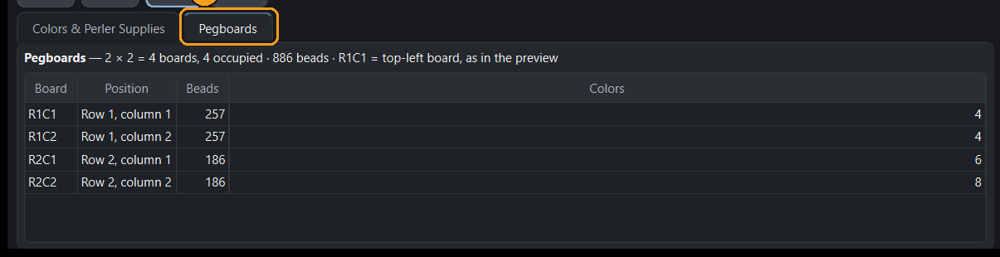

*Figure 11 — The Pegboards tab (shown here while the pegboard lines are moved off the bead
positions, so the counts are unavailable — see section 11).*

Normally each row shows:

- **Board** — the board's name, for example **R1C2** = row 1, column 2.
- **Position** — the same in words.
- **Beads** — beads on that board.
- **Colors** — how many colors that board uses.

**R1C1 is the top-left board**, exactly as seen in the preview. Rows count downward, columns count
to the right.

---

## 11. Adjusting the layers

The automatic layout is usually exactly right. **Adjust Layers** is optional fine-tuning. It
becomes available after the pattern has appeared.

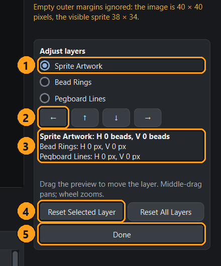

*Figure 12 — The Adjust Layers panel.*

1. **Choose a layer:**
   - **Sprite Artwork** — your beads.
   - **Bead Rings** — the circular bead drawing.
   - **Pegboard Lines** — the white board edges.
2. **Arrow buttons** — move the chosen layer one step. Hold a button to keep moving.
3. **Positions** — how far each layer is from its automatic position. The chosen layer is shown
   in bold.
4. **Reset Selected Layer** — puts only the chosen layer back.
5. **Done** — closes the panel and keeps your changes.

You can also **drag in the preview** with the left mouse button to move the chosen layer. While
the panel is open, use the **middle mouse button** or the scroll bars to move around, and the
mouse wheel to zoom. Moving one layer never moves the other two.

### Moving the sprite artwork

1. Click **Adjust Layers**.
2. Choose **Sprite Artwork**.
3. Click the arrows (or drag in the preview).

The sprite always moves by **whole beads**. The bead count and colors never change; only which
board each bead lands on can change. A green message confirms that everything is still lined up:

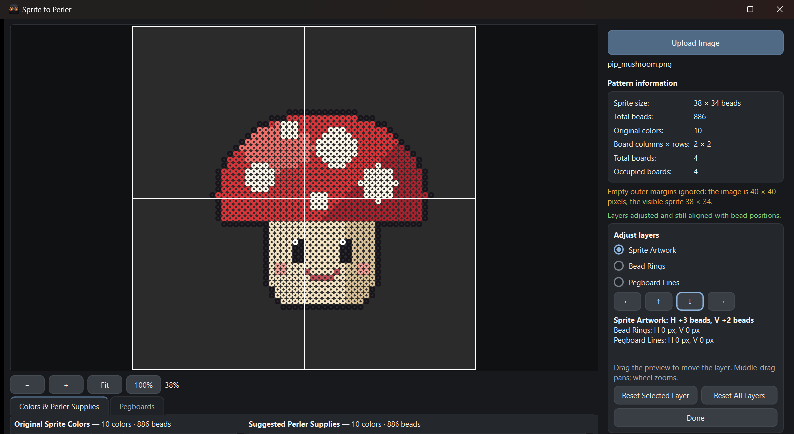

*Figure 13 — Sprite moved 3 beads right and 2 beads down: "Layers adjusted and still aligned with
bead positions."*

The sprite cannot be pushed off the boards. At the edge, the app stops it and explains why:

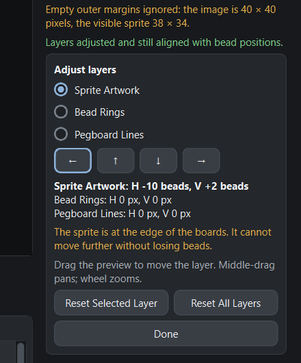

*Figure 14 — "The sprite is at the edge of the boards. It cannot move further without losing
beads."*

### Moving the bead rings

Choose **Bead Rings**. Each arrow click moves the ring drawing by one screen pixel of the saved
picture (a bead is 25 pixels wide). Because the ring drawing repeats every bead, the position is
shown between −12 and +12 pixels.

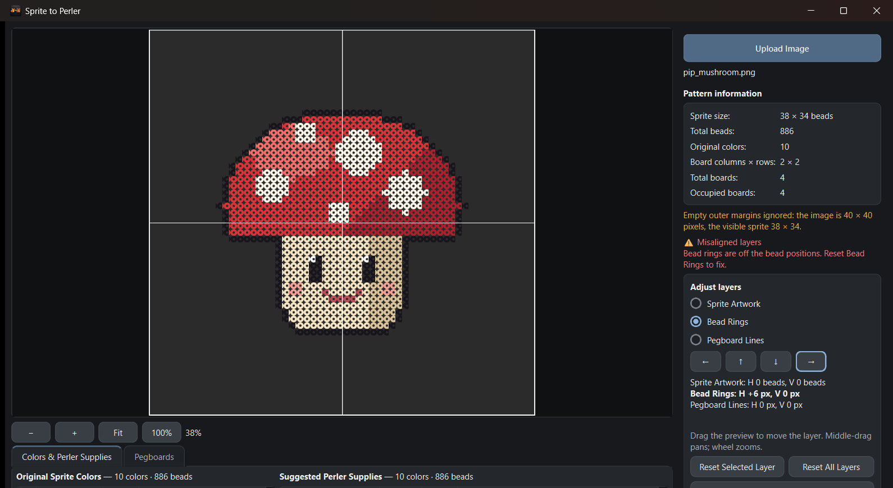

*Figure 15 — Rings moved 6 pixels to the right: a red warning appears.*

### Moving the pegboard lines

Choose **Pegboard Lines**. Each arrow click moves all the white lines together by one pixel. The
spacing between lines never changes. The lines can move at most one whole board in each direction.

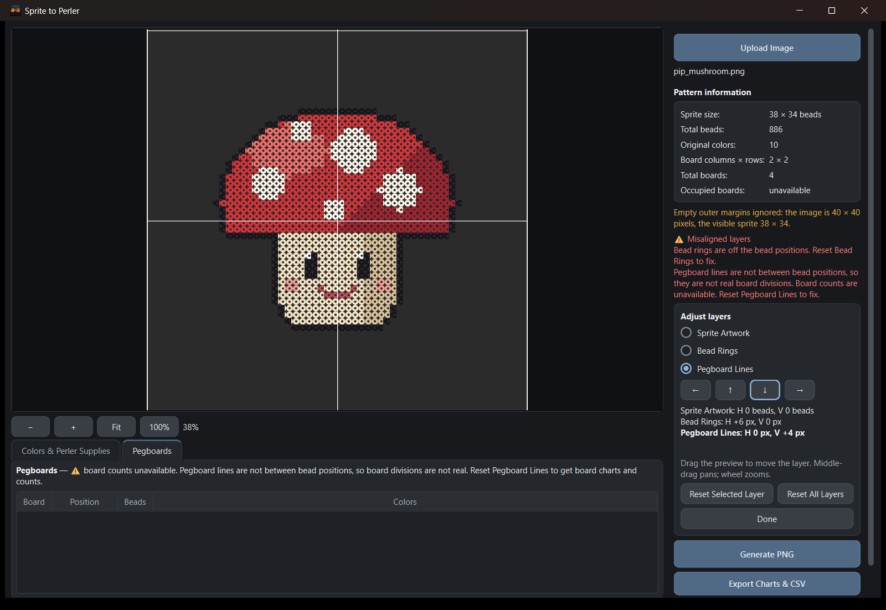

*Figure 16 — Lines moved 4 pixels down (and rings still moved): two red warnings. Occupied boards
and the Pegboards tab show "unavailable".*

### Warnings

| Warning | What it means | What to do |
|---|---|---|
| **Bead rings are off the bead positions** | The circles no longer sit on the beads. | Reset Bead Rings. |
| **Pegboard lines are not between bead positions** | The white lines cut through beads, so they are not real board edges. Board counts and board charts are switched off. | Reset Pegboard Lines, or move them in steps of 25 pixels. |
| **… beads fall outside the marked pegboards** | Some beads are no longer on any board. | Move the sprite back or reset Pegboard Lines. |

### Resetting

- **Reset Selected Layer** — the chosen layer only.
- **Reset All Layers** — everything goes back to the automatic layout.

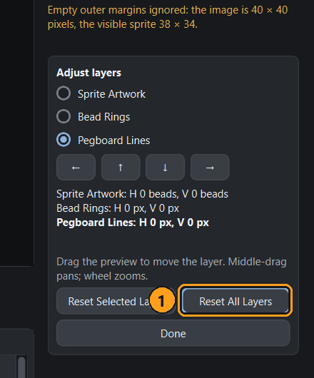

*Figure 17 — Reset All Layers restores the automatic layout.*

Click **Done** when finished. Your adjustments stay until you reset them or load another sprite.

---

## 12. Saving the pattern as a PNG

1. Click **Generate PNG**.
2. Choose a folder and file name. The suggested name is your sprite's name plus
   `_bead_pattern.png`, in the same folder as the sprite.
3. Click **Save**.

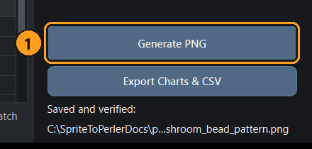

*Figure 18 — "Saved and verified:" with the saved file's location (hover over it to see the full
path).*

- The saved picture is **exactly what the preview shows**, including any layer adjustments, at
  full detail (25 pixels per bead).
- The app checks the saved file before keeping it, so a failed save never leaves a damaged file.
- The app **never overwrites your original sprite**.
- Generate PNG is briefly unavailable while the preview is still updating after an adjustment.

> The PNG is marked as 300 DPI, but printed size has **not** been checked against real
> pegboards. Do not rely on printing it to scale.

---

## 13. Exporting charts and CSV files

1. Click **Export Charts & CSV**.
2. Choose the folder where the files should go and click **Select Folder**.

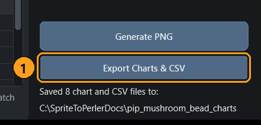

*Figure 19 — "Saved 8 chart and CSV files to:" followed by the new folder.*

The app creates a **new folder** named after your sprite, for example `pip_mushroom_bead_charts`.
If that folder already exists, it creates `pip_mushroom_bead_charts (2)` and so on — nothing is
ever overwritten.

| File | Contents |
|---|---|
| `…_original_colors.csv` | Every sprite color: number, color code, red/green/blue values, beads, suggested Perler color, product code and match difference. |
| `…_perler_supplies.csv` | The Perler shopping list: color, product code, beads, which sprite colors it covers, and where the color data comes from. |
| `…_board_counts.csv` | One row per pegboard: total beads and beads of each color. |
| `…_board_layout.png` | A map of all pegboards with their names and bead counts. |
| `…_board_R1C1.png`, … | One numbered chart for each pegboard that has beads. Empty boards are listed in the CSV only. |

A sample of these files is included in the [sample-output](sample-output/) folder.

> If the pegboard lines are not lined up with the beads (section 11), only the two color files
> are saved, and the app explains why the board charts were left out. Reset the pegboard lines
> and export again to get them.

---

## 14. Reading a pegboard chart

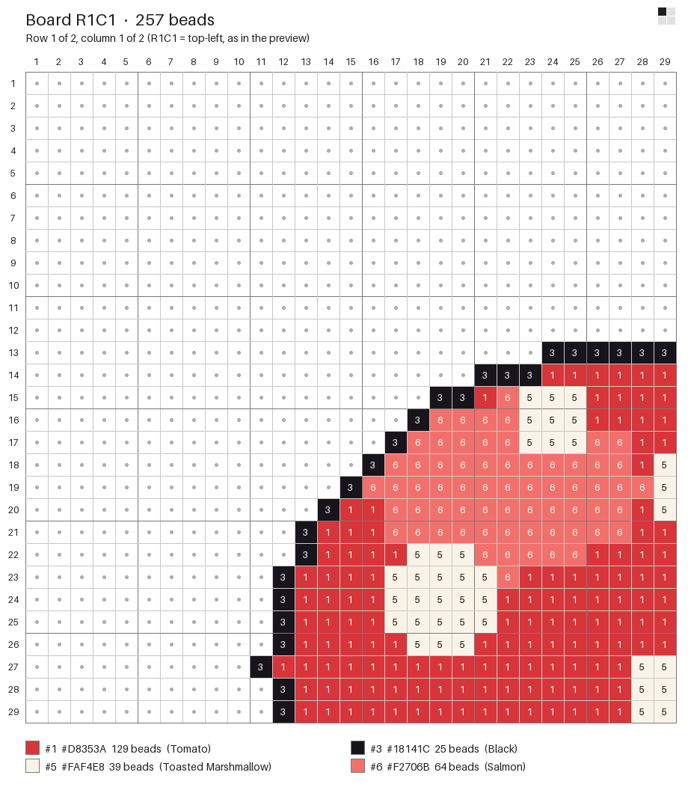

*Figure 20 — Chart for board R1C1 of Pip (from the sample output).*

- **Title** — board name and its bead count.
- **Mini-map** (top right) — the whole layout; the dark square is this board.
- **Peg numbers** — 1 to 29 across the top and down the left side. Every fifth line is darker to
  help counting.
- **Colored squares with numbers** — place a bead of that color. The number is the color number
  from the color key.
- **Small dots** — empty pegs (no bead).
- **Color key** (bottom) — each number with its color code, how many beads of it this board needs,
  and the suggested Perler color.

The charts use your sprite's original colors, viewed from the front, exactly like the preview.

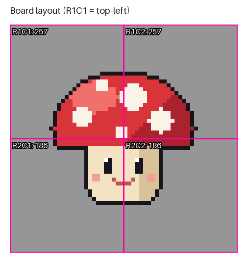

*Figure 21 — The board layout map, showing every board's name and bead count.*

---

## 15. Large sprites

Sprites up to **2,048 × 2,048 pixels** can be loaded — up to about 71 × 71 pegboards.

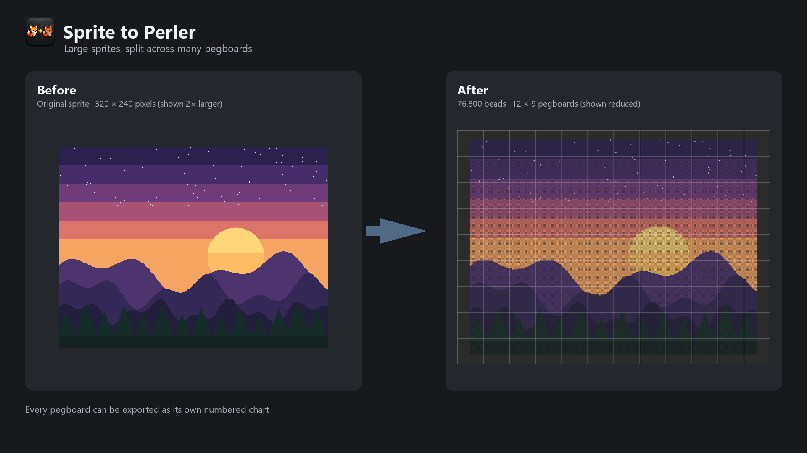

For big patterns (about 7 × 7 pegboards or more):

- The window shows **"Rendering preview… N%"** while the first preview is drawn.
- The preview is first shown at a reduced size, and a note explains this:

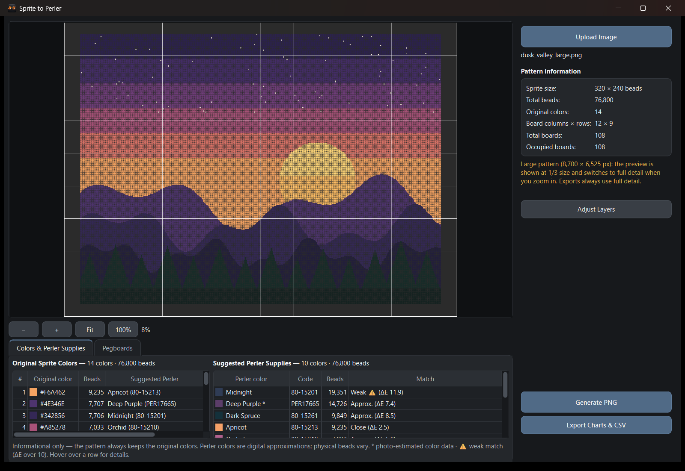

*Figure 22 — "Dusk Valley" (320 × 240 pixels, 12 × 9 pegboards): "Large pattern … the preview is
shown at 1/3 size and switches to full detail when you zoom in."*

- **Zoom in** (for example with **100%**) and the visible part is drawn at full detail:

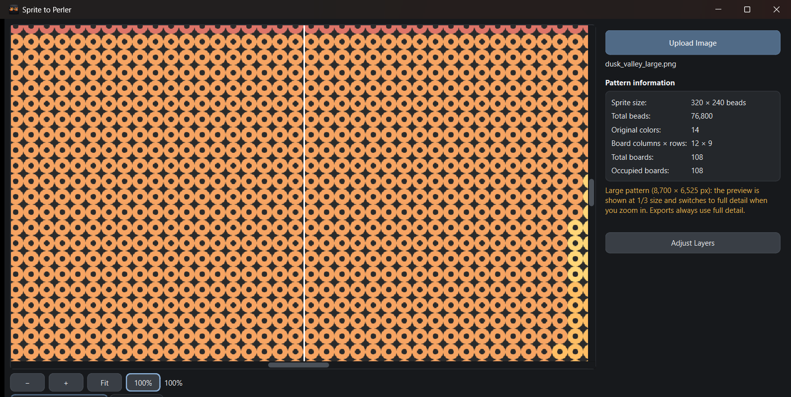

*Figure 23 — The same pattern at 100%: real bead rings and pegboard lines.*

- Bead counts, Perler suggestions and charts always use the full, exact pattern.
- Saved PNGs always use full detail.

**Practical limits**

| Size | What to expect (measured on a typical Windows 11 PC) |
|---|---|
| Up to about 256 × 256 pixels | Preview in about 1 second. |
| 512 × 512 pixels | Preview and each layer move take about 3 seconds. |
| 1,024 × 1,024 pixels | About 11 seconds; saving the PNG about 25 seconds. |
| 2,048 × 2,048 pixels | About 50 seconds per update; exporting charts for its thousands of boards takes about 4 minutes. |

- A single PNG can be saved up to about **1,000 megapixels** (roughly a 1,250 × 1,250 pixel
  sprite). For bigger patterns, **Generate PNG** explains that one picture would be too large and
  suggests **Export Charts & CSV**, which still saves every pegboard as its own chart.
- The window stays usable while large patterns are drawn. Slower computers take longer.

---

## 16. Messages, problems and solutions

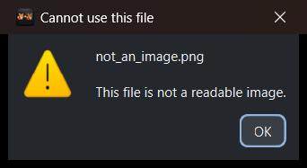

*Figure 24 — Example: a text file renamed to .png.*

| Message | Cause | Solution |
|---|---|---|
| **The file is empty.** | The file has no content. | Choose the real sprite file. |
| **This file is not a readable image.** | The file is not a picture, or is damaged. | Re-save the sprite as PNG or GIF. |
| **Unsupported image type (JPEG). Please use a PNG or GIF sprite.** | Other formats are not accepted. | Save the sprite as PNG. JPEG files also blur pixel colors. |
| **Animated PNG files are not supported.** | The PNG contains an animation. | Save one frame as a normal PNG (or use a GIF). |
| **The image file is damaged or incomplete.** | The file was cut short. | Download or save it again. |
| **The sprite is … pixels. The limit is 2048 x 2048 …** | The image is too big. | Use the original small sprite. If your image was enlarged, shrink it back to its original pixel size in an image editor first. |
| **The sprite has no visible pixels (it is fully transparent).** | Everything is transparent. | Check that you chose the right file. |
| **One sprite at a time** | Several files were dropped at once. | Drop a single file. |
| **Windows did not allow saving in "…".** | That folder is protected. | Choose another folder, such as Documents or Desktop. |
| **"…" could not be replaced. It may be open in another program or read-only.** | The file is in use. | Close it in the other program, or choose a new name. |
| **The pattern cannot be saved over the original sprite file.** | You chose the sprite itself as the save file. | Choose another name. |
| **Single PNG not available** | The pattern is too large for one picture. | Use **Export Charts & CSV**. |
| **Board charts not included** | The pegboard lines are not on the bead positions. | Reset Pegboard Lines, then export again. |

**Something else went wrong?** Unexpected problems are shown in a message window that says
"Your files were not changed." Close the app, start it again, and try once more.

---

## 17. What the app does not do

- **One pixel = one bead.** The app does not change, smooth, or redraw your sprite.
- It does **not cut individual sprites out of a sprite sheet.** Use an outside sprite ripper, then
  load one prepared sprite at a time (see [Getting single sprites from a sprite sheet](#getting-single-sprites-from-a-sprite-sheet)).
- It does **not shrink enlarged pixel art.** A sprite that was blown up to 4× its size is treated
  as 4× more beads. Use the original-size sprite.
- **Perler color suggestions are approximations** from digital color data. They have not been
  checked against real beads.
- **Print size is not verified.** Use the charts to place beads, not a printout at "real size".
- It does not let you choose a different Perler color for a suggestion; the suggestions are for
  information only.

---

## 18. Technical details (optional)

This section is for curious users; you do not need it to use the app.

**Automatic layout.** The visible sprite is the smallest box that contains every bead pixel. The
layout is (width ÷ 29, rounded up) × (height ÷ 29, rounded up) pegboards, and the sprite starts
after half of the spare pegs on each side (rounded down). Layer adjustments are measured from this automatic position.

**Pattern drawing.** Each bead is a 25 × 25 pixel cell in the saved picture. Layers from bottom to
top: dark gray background (#2B2B2B), the sprite's original colors, the bead-ring drawing (taken
from the original Photoshop template), and 3-pixel white pegboard lines every 725 pixels
(29 beads). The preview and the saved PNG come from the same drawing.

**Color matching.** Sprite colors are compared with 118 solid Perler colors using the CIEDE2000
color-difference formula (ΔE). Match labels: Close below 5, Approx. 5–10, Weak above 10. Mixes,
clear, glow, metallic and pearl beads are not suggested. Most color data is community-measured
(the *beadcolors* project); some entries are estimated from product photos (marked \*). When a
measured color is within 1.5 ΔE of a photo-estimated best match, the measured color is preferred.

**Large patterns.** Patterns above 25 megapixels are drawn in strips, so memory use stays low.
The reduced preview is an exact average of the full-detail picture. Big PNGs are written strip
by strip and checked before being kept.

**Saved files.** CSV files use UTF-8 with a byte-order mark, so Excel shows all characters
correctly. Exports are written to a temporary name first and only appear when complete.

---

*Sprite to Perler user guide. Example artwork in this guide ("Pip", "Glob", "Twinkle" and
"Dusk Valley") was created for this documentation. Perler is a brand of its owner; this program is
not affiliated with or endorsed by it.*
